[← back to the README](README.md)

> [!WARNING]
> **Spoiler alert!** This page shows the complete maps of the overworld and of every town, castle and keep. If you want to explore *Die Dunkle Dimension* yourself,
> [play it in your browser](https://dschwen.github.io/die_dunkle_dimension/) first.

<details>
<summary><b>Show the maps</b></summary>

# Maps

All map images are built by running

```
make gather
```

and can be found in the `res` directory.

## World map

The world map is shown to consist of `(39*4) * (39*4)` tiles (as can be seen in the pencil drawing of the map available on the web).
The data is stored in `DDD1/ddd.mapa` (and `DDD1/ddd.code`) and can be plotted with

```
./src/worldmap2png.py
```

The map file contains a `52 x (52*3)` data set (`52*3` == `39*4`).
Each entry represents a strip of `3*1` actual tiles (the subtiles).

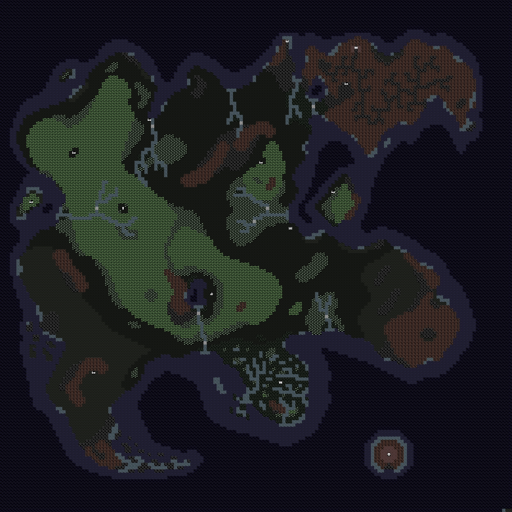

## Submaps

Most submaps of towns and castles are 35 tiles wide.

```
./src/map2png.py c64/DDD1/ddd.mapc 35
```

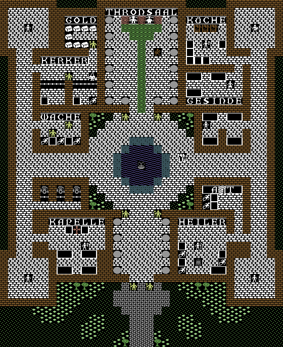
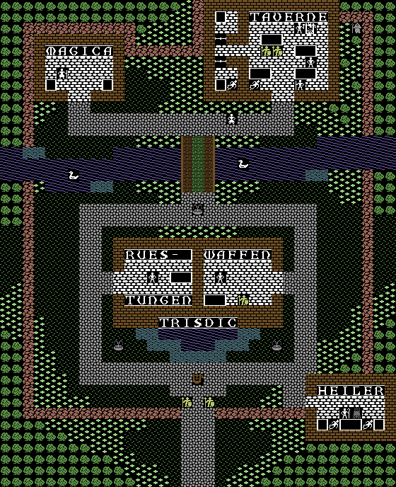
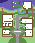
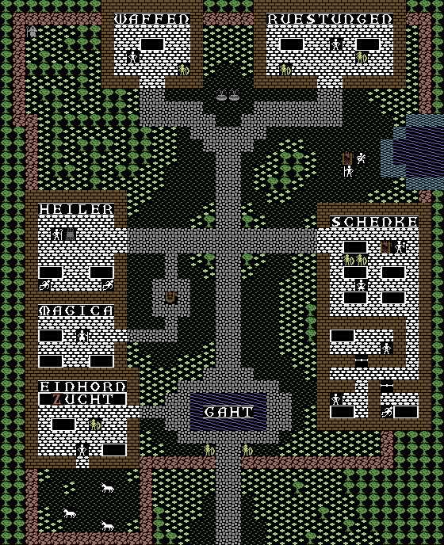
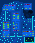
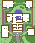

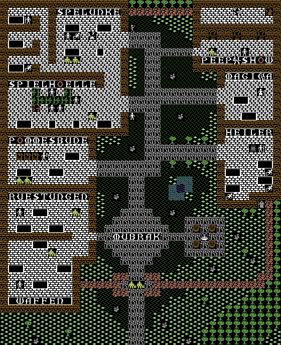

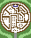
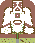


The druid cottage is 11 tiles wide.

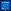

The first-person dungeons (dragon cave and the Vampire Count's crypt) are described in [DUNGEONS.md](DUNGEONS.md);
`make dungeons` writes their floor plans to `res/dungeons`.

</details>
