[Areas of the game](AREAS.md) | [Game files](DDDFILES.md) | [Game state area](FLAGS.md) | [Maps (spoilers!)](MAPS.md) | [Web app](WEBAPP.md)

# Die Dunkle Dimension

### ▶ [Play it in your browser](https://dschwen.github.io/die_dunkle_dimension/)

[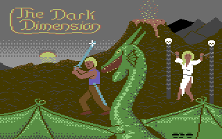](https://dschwen.github.io/die_dunkle_dimension/)

**[dschwen.github.io/die_dunkle_dimension](https://dschwen.github.io/die_dunkle_dimension/)** – the complete 1990 C64
fantasy role-playing game by German Design Group, running in the browser on the original game code: full story,
combat and first-person dungeons, original music and sound, save games in the browser. In German or English, as the
regular (original) or the enhanced edition. See [WEBAPP.md](WEBAPP.md) for how it works.

This repository also documents the reverse engineering of the game's files, graphics and data.

# Graphics

## Extracting palette data

Go to http://www.colodore.com/ and fine tune the palette. Click on the cog wheel
icon in the top right corner and select "PNG Format" to download the palette as
a png file. Use

```
make palette
```

to extract the color info.

## Charsets

```
make chars
```

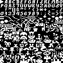
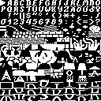
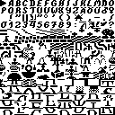
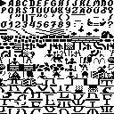
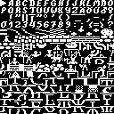
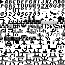
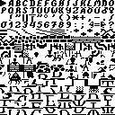
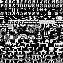
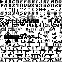
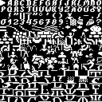
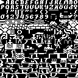
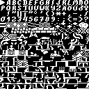
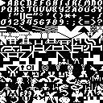
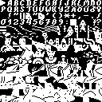
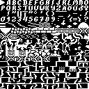
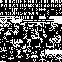

### ...and the tiles they make up

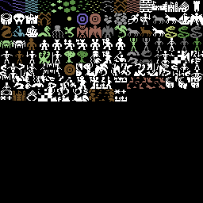
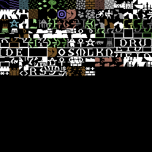
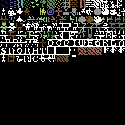
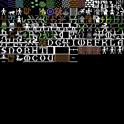
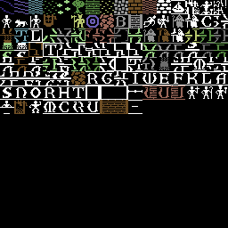
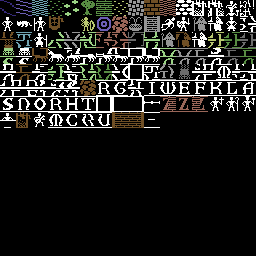
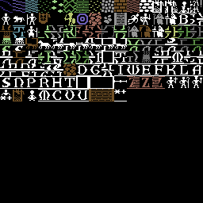
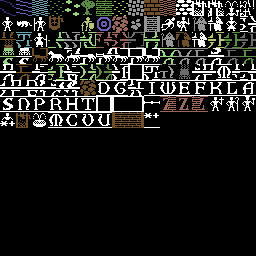
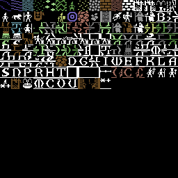
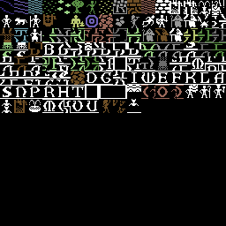
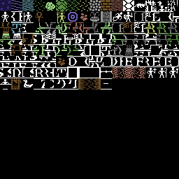
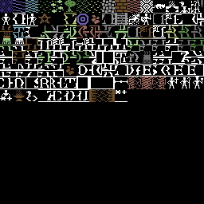
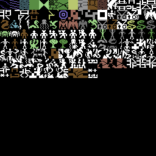
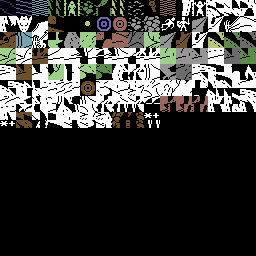
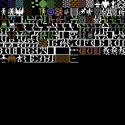
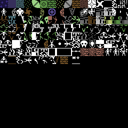

## Sprites

Only one spritesheet seems to be present and it looks like it should be a multicolor sprite

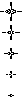
